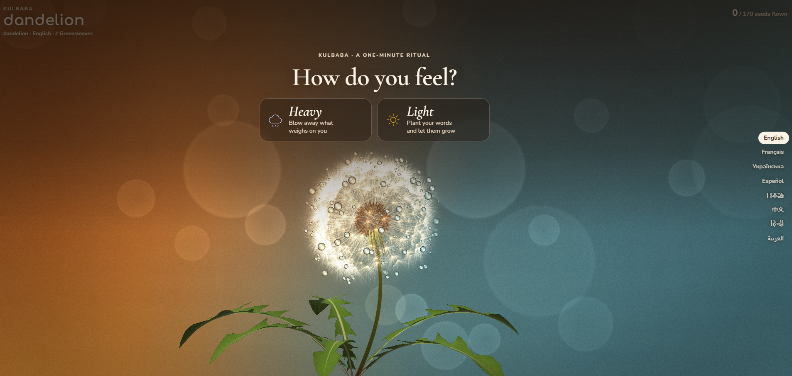

# Kulbaba

🔗 **Live Demo:** [kulbaba.vercel.app](https://kulbaba.vercel.app/)

  

**A one-minute ritual that starts with one question: How do you feel?**

- **Heavy** — write what weighs on you (a doubt, a worry about tomorrow, an old hurt). Breathe in, then blow: each seed that flies off the dew-covered 3D dandelion carries away the next letter of your words, and the letters dissolve in the dusk air. *Let go — and go on.*
- **Light** — write what you want to grow (an idea, a wish, kindness). Blow, and your letters drift down into the meadow; where each one lands, a small yellow dandelion blooms. *Let it grow.*

Blow by holding the button, the space bar, swiping, or with your real breath into the microphone. Your words never leave your device. The ritual speaks 8 languages, and the flying seeds play a traditional tune from each language's country (slower when the heart is heavy).

Built with plain JavaScript, [Three.js](https://threejs.org/) and Web Audio, bundled with [Vite](https://vite.dev/).

## Run it

```bash
npm install
npm run dev       # http://localhost:5173
npm run build     # production build in dist/
npm run preview   # serve the build locally
```

The microphone only works on `localhost` or over HTTPS (GitHub Pages is fine).

## Tune it

Everything visual and physical is in the `CONFIG` object at the top of the script in `index.html`: seed and bristle counts, light colours, dew drops, letter size, wind, depth of field, bloom, grain and quality limits.


